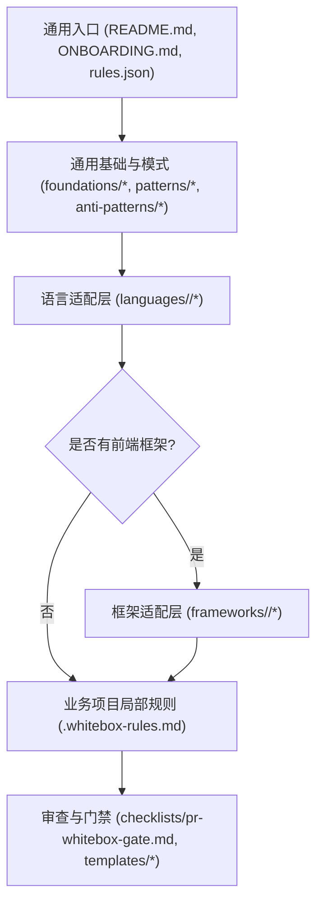

# 业务项目接入与按需加载协议 (ONBOARDING)

本文档面向接入 `cqing-whitebox-code` 的业务项目开发者与 AI Agent，规定如何按需加载规范、处理潜在规则冲突，以及如何落地可验证的代码审查。

---

## 1. 核心理念与分层加载架构

业务项目的技术栈各不相同（如 TypeScript + React、JavaScript + Vue、纯 Python 后端等）。全量加载所有语言与框架规范会迅速耗尽上下文窗口并产生无关认知干扰。

因此，本库采用**分层按需加载协议 (Tiered On-Demand Loading Protocol)**。同一规范正文只在单一位置权威维护，下游只做引用与组合。



### 加载顺序

1. **通用入口与规则注册表**：确定规则 ID（W01 - W12）与全局质量边界。
2. **认知基础与模式反模式**：建立推演路径、状态定位与因果追溯的通用心智模型。
3. **特定语言适配**：提供该语言标准写法（如 TS 判别联合、Python `raise from`）。
4. **特定框架适配**（如有）：提供框架生命周期、状态机与组件边界的最佳实践。
5. **业务项目既有约定**：业务特定业务规则、目录规范与安全隔离域。
6. **PR 门禁与审查模板**：生成可机械比对的验收证据。

---

## 2. 获取最小加载清单

使用仓库自带的零依赖解析脚本 `scripts/resolve-profile.mjs` 获取当前项目所需的精准文件列表：

### 命令行调用方式

```bash
# 场景 1: TypeScript + React 项目
node scripts/resolve-profile.mjs --language typescript --framework react

# 场景 2: Python 纯语言后端项目
node scripts/resolve-profile.mjs --language python

# 场景 3: 以 JSON 数组形式输出，供构建脚本自动化消费
node scripts/resolve-profile.mjs -l typescript -f vue --json
```

输出的路径均为相对于本规范库根目录的相对路径。解析器会执行严格校验：未知语言、未知框架、不兼容组合（例如 `python + react`）或清单包含不存在的文件均会返回非零退出码并报错。

---

## 3. 规范冲突与优先级决议矩阵

当通用规则、语言惯用法、框架约定与业务项目既有约定产生潜在分歧时，必须严格执行以下**仲裁优先级**（由高到低）：

| 优先级 | 维度 | 仲裁原则与执行标准 |
|---|---|---|
| **P0 (最高)** | **业务需求正确性与安全边界** | 绝不为了遵守代码“洁癖”而裁减已确认的业务逻辑、权限控制或边缘保护。 |
| **P1** | **跨语言白盒契约 (rules.json)** | W01 (禁止吞错)、W02 (禁止未声明共享修改) 等契约是底线，任何语言/框架不得打破。 |
| **P2** | **语言/框架权威惯用法** | 语言与框架推荐写法（如 React 用 Hook，Python 用上下文管理器）可替换通用伪代码，但不得违背白盒目标。 |
| **P3** | **业务项目局部约定** | 业务项目自己的命名风格、目录分层、偏好配置。业务约定可进一步收紧规则，但不得降低 P0/P1 的质量标准。 |

### 冲突示例与处理方法

- **冲突场景 1：框架文档建议在 `catch` 中设置降级状态，但 W01 禁止吞错**  
  *仲裁*：设置降级 UI 状态的同时，必须在处置边界保留调试因果，或向监控网关上报带 cause 的错误，不得无声吞噬。
- **冲突场景 2：现有项目遗留代码存在深层嵌套，重构风险巨大**  
  *仲裁*：W04 规定嵌套 $>3$ 是“审查信号”而非机械自动失败项。新代码必须扁平化；对老代码修改时，若重构涉及高危不可控回归，允许填写【例外说明】并提供回归测试证据。
- **冲突场景 3：外部第三方库返回不可控的动态数据结构**  
  *仲裁*：W06 强调在系统 I/O 边界进行运行时防御性收窄（如 Zod 校验或类型保护断言），一旦进入内部私有模块，便应信任不变式并消除多余的伪防御。

---

## 4. 与 `cqing-better-code` 协同指南

若当前项目已接入 `cqing-better-code` 流程门控体系，两者的对接点如下：

1. **开工准备 (Step 1)**：在开工核对任务时，指定当前任务适用的 `profile`（例如 `typescript-react`），通过解析脚本获取规范清单并由 Agent 阅读。
2. **权限门控 (BER Gate)**：继续遵守 `cqing-better-code` 的“写代码前必须显式求授权”原则，本规范不额外增设流程审批卡点。
3. **完成定义 (DoD)**：在交付验收时，除了原有的 VVC 验证证据外，增加白盒审查证据：
   - 证明所有关键失败分支均有因果追溯（W01/W07）；
   - 证明状态变更均属声明内操作（W02/W05）；
   - PR 审查清单填写实际 `file:line` 证据。
