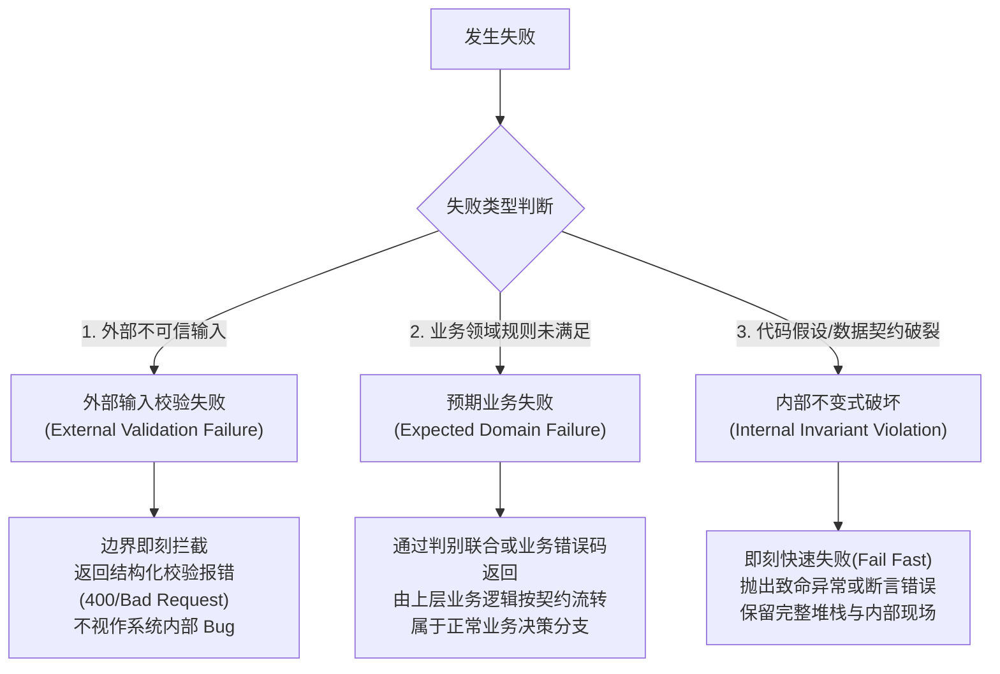
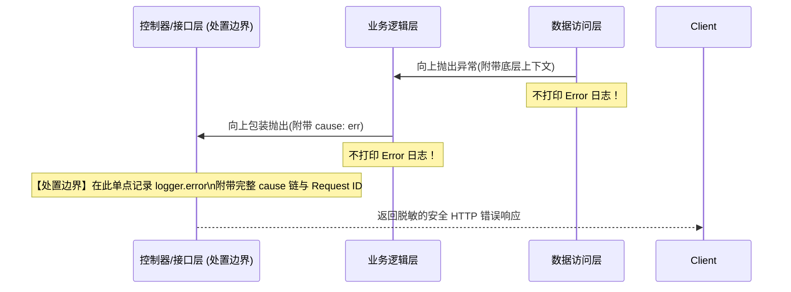

# 因果追溯：失败分类、链路保留与单点记录

> 核心目标：在分布式系统与现代复杂应用中，失败并非异常意外，而是系统的第一类公民。白盒代码必须保证任何线上故障或预期业务拒绝均能通过因果链（Causal Chain）精准还原其初始根因，严禁失败信息在传递过程中无声丢失。

---

## 1. 失败的三层分类法

为了避免把所有异常混为一谈，白盒规范将系统遭遇的失败清晰划分为三类，并施加不同的处理策略：



### 1.1 外部输入校验失败 (External Validation Failure)
- **定义**：来自网络请求、用户输入、第三方 webhook 等不可控外部来源的数据不符合预定格式或基础约束。
- **策略**：在系统最外层 I/O 边界（Controller、API Gateway、表单提交处理器）使用 Schema 校验工具进行严格拦截，向调用方输出结构清晰的字段级错误提示。不将此类问题当做系统崩溃处理，无需打印 Error 级别系统报警堆栈。

### 1.2 预期业务失败 (Expected Domain Failure)
- **定义**：输入合法，但在领域规则约束下无法完成操作。例如：“用户余额不足”、“商品库存售罄”、“优惠券已被使用”。
- **策略**：属于领域模型的合法分支。应使用显式的结果类型（如 `Result<T, DomainError>`）或具有业务错误码的异常对象，由上层调用方进行明确的业务降级或给用户呈现业务提示。

### 1.3 内部不变式破坏 (Internal Invariant Violation)
- **定义**：系统内部本已通过前置校验，或根据架构约定绝对不应该进入的状态被打破。例如：内部哈希表找不到前文刚写入的记录、状态机跳转到 `never` 分支、数据库外键完整性出现不可能的孤儿数据。
- **策略**：**快速失败 (Fail Fast)**。切勿使用兜底默认值掩盖错误。必须立即抛出异常或触发断言中断，避免在损坏的状态上继续执行导致雪崩式数据污染。

---

## 2. 错误因果保留 (Preserve Cause Chain)

在多层调用或微服务交互中，底层抛出的异常（如网络超时、数据库连接断开、JSON 解析失败）在经过服务层包装时，常常被粗暴地转换为顶层业务异常：

```typescript
// 错误示范：因果链断裂
try {
  await db.query(sql);
} catch (err) {
  // 原始 err 及其调用栈、底层系统错误码在此彻底丢失！
  throw new Error("Failed to load user profile");
}
```

### 白盒规范要求：
- **保留原始 Cause**：必须使用语言原生或规范机制附带原始错误。
  - 在 JavaScript/TypeScript (ES2022+) 中：`throw new AppError("Failed to load user profile", { cause: err });`
  - 在 Python (PEP 3134) 中：`raise AppError("Failed to load user profile") from err`
- **携带安全结构化上下文**：为错误对象附加定位问题所必需的不可变上下文参数（如 `{ userId, orderId }`），但不得泄露凭证、密钥或敏感个人信息（PII）。

---

## 3. 边界单点记录 (Single-Point Logging at Boundaries)

常见的黑盒日志反模式是“层层打印”：
底层 DAO 捕获异常打印一次 `logger.error`，Service 层捕获后又打印一次 `logger.error`，Controller 层又打印一次。结果造成日志洪泛，在并发场景下多条互不相关的同一错误日志交织在一起，极大干扰故障排查。



### 单点记录三原则：
1. **单一处置责任**：哪个层级负责将错误转化为最终响应或事务回滚，哪个层级就是处置边界。通常是统一请求拦截器、事件驱动消费者根节点或定时任务执行体。
2. **中间层只透传或包装**：中间层只负责补充当前层的业务上下文并重新抛出，不在中间层反复打印 Error 日志。
3. **关联标识 (Correlation ID)**：每一条日志均应通过上下文追踪机制（如 AsyncLocalStorage、TraceContext、MDC）绑定全局唯一的 `traceId` / `requestId`。

---

## 4. 绝对底线：禁止无声丢失失败 (P0 规则)

- 绝对禁止空的 `catch (e) {}`。
- 绝对禁止未处理的异步 Promise rejection。
- 绝对禁止为了防止界面报错而大面积追加伪防御性的空值假冒通过（如把未初始化的关键数据偷偷 fallback 为 `""` 或 `{}` 继续执行）。
- 如确需降级（Fallback），降级逻辑必须显式声明其为降级分支，并在调试/告警日志中记录被降级的底层异常。
